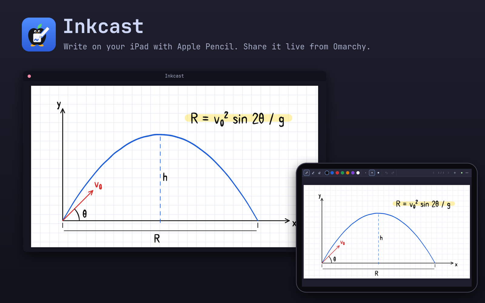

# Inkcast


Use an iPad and Apple Pencil as a drawing tablet for your computer. You write
in Safari on the iPad, and the ink appears live in a window on the computer
that you can share in Zoom, Teams or Meet. You can write on blank paper, a
PDF, or a live view of any desktop window.

It runs on Omarchy (as a bar plugin), other Linux distributions, macOS and
Windows 11. A small Python server runs on your computer only while you have it
switched on. Nothing is installed on the iPad, and no data leaves your local
network.



## What works where

| | Omarchy | Other Linux | macOS | Windows 11 |
| --- | --- | --- | --- | --- |
| Whiteboard, PDFs, share window | yes | yes | yes | yes |
| Annotate a desktop window | system picker | system picker, or Chrome/Edge | Chrome/Edge | Edge/Chrome |
| Mirror the iPad (AirPlay) | UxPlay | UxPlay | built into macOS | no |
| Bar widget, theme matching | yes | no | no | no |

You need an iPad with Safari on the same Wi-Fi network as the computer, and
Python 3.9 or newer on the computer. There are no pip packages. Writing on PDFs
needs Poppler, which each setup below installs if you agree.

## Install

### Omarchy

```bash
omarchy plugin add https://github.com/0w3n-N/inkcast.git --enable
```

Click the new Inkcast icon in the bar and choose **Setup**. It runs
`scripts/setup` in a terminal, and every step asks first:

1. Install Poppler and the window-capture packages if they're missing.
2. Optional: install UxPlay (AUR) and enable avahi-daemon for AirPlay.
3. Open ufw for TCP 8770, plus the AirPlay ports if UxPlay is installed.
   The rules only allow private network ranges.
4. Optional: add an `inkcast` command and launcher entries.

Update with `omarchy plugin update io.github.0w3n-n.inkcast`. To remove:

```bash
~/.config/omarchy/plugins/io.github.0w3n-n.inkcast/scripts/uninstall
omarchy plugin remove io.github.0w3n-n.inkcast
```

### Other Linux

Install the packages for your distribution. Only Python is required; the rest
enable PDFs, window annotation and AirPlay.

```bash
# Arch
sudo pacman -S python poppler python-gobject gst-plugin-pipewire gst-plugins-good
# Debian, Ubuntu
sudo apt install python3 poppler-utils python3-gi gir1.2-gstreamer-1.0 gstreamer1.0-pipewire gstreamer1.0-plugins-good uxplay
# Fedora
sudo dnf install python3 poppler-utils python3-gobject gstreamer1-plugins-good pipewire-gstreamer uxplay
```

Then get Inkcast and run its setup (firewall, `inkcast` command, launcher entry):

```bash
git clone https://github.com/0w3n-N/inkcast.git ~/inkcast
~/inkcast/scripts/setup
~/inkcast/bin/inkcast
```

Setup handles ufw. With firewalld, open the port yourself:
`sudo firewall-cmd --permanent --zone=home --add-port=8770/tcp && sudo firewall-cmd --reload`,
and make sure your Wi-Fi connection is in the `home` zone.

Window annotation uses your desktop's screen-share portal (GNOME, KDE and
wlroots desktops have one). Without the GStreamer packages, Inkcast captures
windows through Chrome or Edge instead, as on macOS.

Update with `git -C ~/inkcast pull`. Remove with `~/inkcast/scripts/uninstall`,
then delete the folder.

### macOS

```bash
brew install poppler            # optional, for PDFs
git clone https://github.com/0w3n-N/inkcast.git ~/inkcast
~/inkcast/scripts/setup         # offers to add an `inkcast` command
~/inkcast/bin/inkcast
```

The `python3` that comes with macOS (Xcode Command Line Tools) is new enough.
macOS installs it the first time you run `git` or `python3`.

- If the macOS firewall is on, allow incoming connections for Python when asked.
- To annotate windows, install Chrome or Edge. The first time, macOS asks you to
  allow screen recording for the browser (System Settings › Privacy & Security ›
  Screen & System Audio Recording).
- For mirroring, use the built-in AirPlay Receiver (System Settings › General ›
  AirDrop & Handoff).

Update with `git -C ~/inkcast pull`. To remove, delete the folder and
`~/Library/Application Support/inkcast`.

### Windows 11

1. Get the code. Either install Git (`winget install -e --id Git.Git`) and run
   `git clone https://github.com/0w3n-N/inkcast.git`, or use **Code ›
   Download ZIP** on GitHub and extract it, e.g. to `Documents\inkcast`.
2. Open the folder, right-click inside it, choose **Open in Terminal**, and run:

   ```powershell
   powershell -ExecutionPolicy Bypass -File scripts\setup.ps1
   ```

   It asks before each step:
   - Install Python 3.12 and Poppler with winget, if they're missing.
   - Add a firewall rule for TCP 8770 on private networks. Windows shows an
     admin prompt.
   - If your Wi-Fi is marked Public, offer to mark it Private. Do this only on
     your own network.
   - Add a Start menu shortcut and an optional `inkcast` command.
3. Start **Inkcast** from the Start menu. If Windows Defender Firewall asks
   about Python, allow **Private networks**.

Window annotation uses Edge, which comes with Windows: click **Window** in the
Inkcast window and pick the window. AirPlay mirroring isn't available on
Windows.

Update with `git pull`, or download the ZIP again. To remove, run
`powershell -ExecutionPolicy Bypass -File scripts\uninstall.ps1`, then delete
the folder.

## Use

### Pair the iPad

1. Start Inkcast: switch it on from the bar icon (Omarchy), the Start menu
   (Windows), or run `inkcast`. The share window opens with a QR code.
2. Scan the QR code with the iPad Camera app. The page opens in Safari.
3. Optional: Share › **Add to Home Screen** for a full-screen app. The link
   includes the pairing key, so keep it private.

### Share your writing

In Zoom, Teams or Meet, share the window titled **Inkcast**. Its controls hide
when the mouse is still, so they don't show up on the call.

### Write on a PDF

On the iPad, choose ⋯ › **Open PDF**, or drop a PDF onto the share window.
Each PDF page becomes a page you can write on. Save the whole notebook, ink
included, with ⋯ › **Save notebook as PDF** or `S` in the share window.

### Annotate a desktop window

Show one desktop window (slides, code, a simulation, a web page) on the iPad
and draw over it:

1. Start it with **Annotate a window** (Omarchy bar popup), **Window** in the
   share window, ⋯ on the iPad, or `inkcast annotate`.
2. Pick the window on the computer. Linux uses the system share picker. On
   macOS and Windows, click **Choose a window** in the share window and pick
   it in the browser's dialog. Someone at the iPad can't skip this step.
3. The window appears on the iPad as a new page, updating live at up to 15
   frames per second. Draw on it with the normal tools. Pinch-zoom on the iPad
   to look closer; this doesn't change the window or the share window.
4. Stop it from the same places. The last frame stays on the page.

The ink is placed on the page, not tied to the window's content, so it doesn't
follow when the window scrolls. On macOS and Windows, keep the share window open
while a window is live; it does the capturing.

### Mirror the iPad (AirPlay, Linux)

Toggle **AirPlay receiver** in the bar popup, or run `inkcast mirror`. On the
iPad: Control Center › Screen Mirroring › **Omarchy**, then enter the 4-digit
PIN shown in the popup or terminal. Devices are remembered after the first PIN.

## Controls

**iPad**

| Input | Action |
| --- | --- |
| Pencil | draw, highlight or erase, with pressure |
| Pencil tip double-tap on one spot | switch between pen and eraser (turn off in ⋯) |
| One finger | pan |
| Two fingers | zoom (iPad only) |
| ⋯ | PDFs, desktop window, paper style, clear/delete page, new notebook, save as PDF, finger drawing |

The Pencil's barrel double-tap only reaches native apps; Safari doesn't pass it
to web pages. A quick double-tap of the tip on the screen does the same job,
and the two dots it leaves are removed.

**Share window**

| Input | Action |
| --- | --- |
| Mouse wheel / pinch | zoom at the pointer |
| Drag / two-finger scroll | pan |
| Double-click, `0` | zoom 2×, back to fit |
| `+` `-` | zoom in, out |
| `L` | follow the pen while zoomed (on by default) |
| `←` `→` Space | change page (the iPad follows) |
| `W` | annotate a desktop window / stop |
| `O` `S` `Q` `F` | open PDF, save PDF, pairing QR, full screen |

**Omarchy bar icon**

- **Clicks:** left-click opens the popup, right-click opens the share window,
  and middle-click toggles AirPlay.
- **Color:** dimmed when off, normal while waiting for the iPad, and the accent
  color while the iPad is connected, a window is live, or mirroring is on.
- **Keybindings:** call it with
  `omarchy-shell io.github.0w3n-n.inkcast <action>`, where the action is
  `board`, `toggle`, `annotate`, `mirror`, `start` or `stop`.
- **Settings:** `port`, `airplayName` and `airplayAudio`, on the widget's entry
  in `~/.config/omarchy/shell.json`.

## Command line

On Linux and macOS, run `inkcast` if setup added it, otherwise `bin/inkcast`.
On Windows, run `inkcast` if setup added it to PATH, otherwise `bin\inkcast.cmd`.

```
inkcast              start if needed and open the share window
inkcast annotate     annotate a desktop window (--stop to end it)
inkcast url          print the iPad link and QR code
inkcast status       running, connected devices (--json)
inkcast doctor       check packages, firewall and network
inkcast start|stop   start or stop the server
inkcast mirror       AirPlay receiver on Linux (--pin, --no-pin, --no-audio, --name)
```

`--port` sets the port. `--host` sets the address shown to the iPad if the
wrong one is picked; VPN and virtual adapters are skipped automatically.

## Troubleshooting

Run `inkcast doctor` first.

- **The iPad can't open the page.** Common causes:
  - The firewall blocks the port: run setup.
  - The iPad is on a different network. Guest Wi-Fi often isolates devices.
  - Windows has your Wi-Fi marked Public: setup can change it.
  - A VPN on the computer blocks LAN traffic. With ProtonVPN, allow LAN
    connections in its settings.
- **"This link is missing its key".** The key changed. Scan the QR code again.
- **The window picker doesn't appear (Linux).** Check that your desktop's
  portal is running, e.g. `systemctl --user status xdg-desktop-portal-hyprland`.
- **Can't capture a window (macOS).** Allow screen recording for the browser,
  then restart the browser.
- **AirPlay doesn't list your computer (Linux).** avahi-daemon must be running,
  and the AirPlay ports must be open. Setup does both.

| | Data | Log |
| --- | --- | --- |
| Linux | `~/.local/share/inkcast/` | `~/.local/state/inkcast/server.log` |
| macOS | `~/Library/Application Support/inkcast/` | `~/Library/Logs/inkcast/server.log` |
| Windows | `%LOCALAPPDATA%\Inkcast\` | `%LOCALAPPDATA%\Inkcast\logs\server.log` |

## Security

Only devices that scanned your QR code can see or change the notebook. The
connection is plain HTTP, so use it on networks you trust. See
[SECURITY.md](SECURITY.md) for details.

## Development

- `python3 -B tests/run.py` runs the security, protocol and annotation tests on
  Linux. They need Poppler and GStreamer.
- `python3 -B tests/smoke.py` runs on Linux, macOS and Windows: it starts the
  real server through the CLI, pairs, connects and stops it.
- GitHub Actions runs the full suite on Linux, and the smoke test on Windows
  and macOS with Python 3.9 and 3.13 (`.github/workflows/tests.yml`).
- `python3 assets/build-icons.py` regenerates the icons. It needs Inkscape.
- Layout:
  - `inkcast/`: server, CLI, QR encoder, window capture, theme.
  - `web/`: the iPad page and the share window.
  - `Panel.qml`, `InkcastIcon.qml`, `Model.js`: the Omarchy bar widget.
  - `scripts/`: setup and uninstall for Linux/macOS (bash) and Windows
    (PowerShell).

## License

MIT. The icon is original artwork; the apple is a generic fruit, not Apple's logo.
